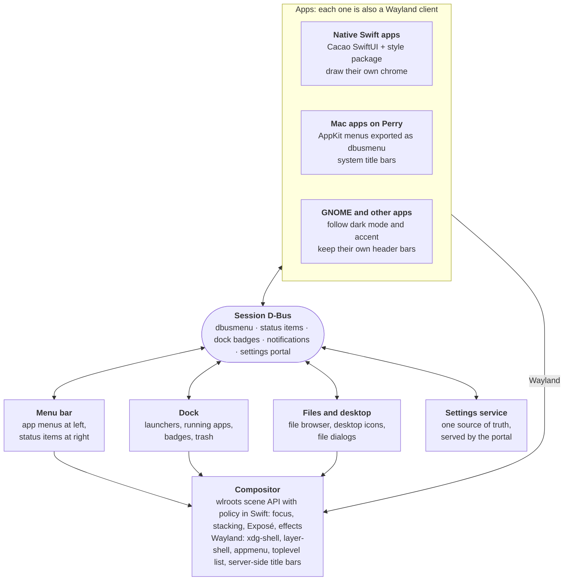

# Desktop environment plan

2026-11-23 · Alsey Coleman Miller

## Summary

The desktop is five Swift processes on Wayland: a compositor, a menu bar, a dock, a file manager that also owns the desktop, and a settings service. Everything the user sees is drawn with Cacao's SwiftUI. Native Linux Swift apps are the first audience. Perry is the second: loaded Mac apps get their menus in the global menu bar, an icon in the dock, and controls that match the system look.

The shape follows elementary's Pantheon (window manager, panel, dock, files, a shared look), rebuilt without GTK and with a global menu bar added.

Decisions already made:

- **SwiftUI on Cacao** for the shell and the built-in apps. No AppKit-style retained view layer is part of this plan.
- **No GTK or GNOME libraries in the shell.** GNOME apps still run as ordinary Wayland clients and follow dark mode, accent color and button layout.
- **Existing protocols first.** `com.canonical.dbusmenu` for menus, the KDE appmenu Wayland protocol to tie a menu to a window, layer-shell for shell surfaces, and xdg-desktop-portal for settings and dialogs. Only the dock-to-compositor link is private.
- **Shell first, compositor second.** The dock, menu bar and file manager are built under sway, then the stand-in is replaced by the new compositor.
- **Borrowed open artwork.** Icons come from elementary's icon theme, with GNOME's as the fallback. Nothing comes from Apple.
- **One compositor, three modes.** Desktop, tablet and phone are modes of the same compositor and shell, chosen per screen. Desktop is finished before tablet or phone work starts.

## Architecture

Apps publish menus, badges and status items on the session bus and read settings from it, and the shell processes sit at the other end of each. Every app is also a Wayland client of the compositor. The compositor is the only piece that knows which window is focused, so it tells the menu bar whose menu to show. The settings service has no window of its own, so it only talks over the bus.

## Components

Five pieces are new, and two existing repos change.

The shell repo is [MillerTechnologyPeru/swift-linux-shell](https://github.com/MillerTechnologyPeru/swift-linux-shell), created on 2026-11-23 under the MIT license. It holds only a README so far.

| Component | Where it lives | State today |
| --- | --- | --- |
| Compositor | New shell repo | Not started; sway stands in |
| Menu bar | New shell repo | Not started |
| Dock | New shell repo | Not started |
| Settings service and portal backend | New shell repo | Not started |
| File manager and desktop | Its own app repo | Not started |
| Style package and host changes | Cacao | SwiftUI coverage exists; shell surfaces and chrome do not |
| Mac app integration | Perry | Menus drawn in-window; no dock or status items |

### Compositor

- Built on the wlroots scene API through a thin C shim, with window policy (focus, stacking, placement) in Swift.
- Speaks xdg-shell, layer-shell, xdg-decoration, the KDE appmenu protocol, a window list for the dock, xdg-activation, text-input, primary selection, fractional scale and cursor-shape. XWayland comes later.
- Draws title bars in the system style for apps that ask for server-side decorations. That covers Perry's Mac apps, Qt apps and SDL games.
- Carries one private protocol for the dock: minimize target, window previews and the Exposé trigger.
- Shadows, rounded corners and blur behind the dock and menu bar sit behind a switch. SceneFX is the candidate, since it replaces the scene API in place.

### Menu bar

- A layer-shell surface on the top edge with an exclusive zone, drawn in SwiftUI.
- Left side: the focused window's menus, read from its `com.canonical.dbusmenu` object. The compositor supplies the service name and object path for the focused window.
- Apps with no exported menu get a default app menu with About and Quit, built from their desktop entry.
- Right side: status items through a StatusNotifierItem host, plus built-in clock, volume, network and battery views.
- Keyboard shortcuts stay inside each app. The bar only displays and activates items.

### Dock

- A layer-shell surface on the bottom edge.
- Pinned launchers come from desktop entries. Running apps come from the compositor's window list, matched by Wayland `app_id`.
- Badges, progress and per-app dock menus use `com.canonical.Unity.LauncherEntry`, the existing D-Bus interface for launcher badges, so no new one is needed.
- Holds minimized windows and the trash.

### File manager and desktop

- The window is a `NavigationSplitView` with a sectioned sidebar, an icon grid, a toolbar and search. Cacao's coverage doc lists all of these as supported.
- The same process owns the desktop: a layer-shell background surface with the wallpaper and icons.
- It backs the portal file chooser, so every app shows the same open and save dialog.
- Trash, mounts through UDisks2, and thumbnails.

### Settings service and portal backend

- A daemon with no UI that holds appearance state: color scheme, accent color, contrast, button layout, fonts, icon theme and cursor theme.
- Implements `org.freedesktop.impl.portal.Settings` and emits `SettingChanged`.
- Answers `org.gnome.*` reads through the same portal, which is how Flatpak GTK apps ask. GNOME apps come only from Flatpak, so the host needs no dconf or GSettings store.
- It is the only settings provider on the system. Two providers that disagree is a known failure on other desktops.
- Later additions: the file chooser portal (delegating to the file manager), notifications, screenshot and screencast, and inhibit.

### Style package (Cacao)

- SwiftUI styles for buttons, segmented controls, search fields, sidebar lists, toolbars, menus and window chrome with left-side window buttons.
- Colors, gradients, radii, fonts and metrics live in a small module with no SwiftUI dependency, so Perry's AppKit can read the same values.
- Light and dark variants, tinted by the accent color.

### Cacao host changes

- **Layer-shell surfaces.** SDL3 can create a roleless Wayland surface and still handle input and rendering. `CacaoWayland` assigns the layer-shell role and handles its configure events.
- **Borderless windows** with drag and resize hit regions, so the style package can draw the title bar and toolbar as one surface. `CacaoHost` creates system-decorated windows today.
- **Menu export.** `commands` and `CommandMenu` are published as a dbusmenu object and tied to the window with the appmenu protocol. On Linux they only provide shortcuts today.
- **Live appearance.** Subscribe to `SettingChanged` and add accent color. The fallback path in `DesktopAppearance` asks once and never hears changes.
- **App identity.** Set the Wayland `app_id` from the bundle identifier.
- **PureSwift/DBus as the shared D-Bus library**, used by Cacao, Perry and every shell process.
- **Icon themes.** Look icons up by name in a freedesktop icon theme, with the Phosphor symbols behind `Image(systemName:)` as the fallback. The distro build renders the theme's SVGs to PNG at the sizes in use, so no SVG renderer is needed on the device.

### Shell repo layout

`swift-linux-shell` is one Swift package with four executables, one shared library and two C targets. Scaffolding it is the first task of phase 1.

| Target | Kind | Contents |
| --- | --- | --- |
| `CacaoWindowServer` | Executable | The compositor: window policy for each form factor, protocol handlers and title bar drawing |
| `CacaoMenuBar` | Executable | The menu bar, and the status bar in tablet and phone modes |
| `CacaoDock` | Executable | The dock, the app grid and launcher entries |
| `CacaoSettings` | Executable | The settings daemon and portal backend |
| `CacaoShellKit` | Library | Code the four share: form factor, desktop entries, D-Bus interface definitions and the Swift side of the dock protocol |
| `CWLRoots` | C target | wlroots headers and the listener glue |
| `CShellProtocols` | C target | Code generated from protocol XML: layer-shell, appmenu and the private dock protocol |

Other paths in the repo:

- `Documentation/Plan.md` holds this plan, exported as Markdown.
- `Protocols/` holds the XML for the private dock protocol.
- `Data/` holds the portal registration file, D-Bus service files, the session entry and the sway config for the stand-in session.
- A CMake build sits beside SwiftPM, as in Cacao, so Buildroot can package it.

Rules for the repo:

- **Dependencies.** Cacao, PureSwift/DBus and the system's wlroots and Wayland libraries.
- **Names.** No target reuses a Cacao module name. `CacaoCompositor`, `CacaoHost`, `CacaoWayland`, `CacaoRender` and `CacaoSDL` are taken.
- **Shared menu code lives in Cacao.** The dbusmenu exporter and reader go in a Cacao target with no SwiftUI dependency, because Cacao apps, Perry and the menu bar all use them.
- **Layer-shell client support lives in Cacao** too, in `CacaoHost` and `CacaoWayland`, so any Cacao app can use it.
- **No GPL artwork.** The repo is MIT. The elementary icon theme ships as its own package.

## Perry integration

Perry needs five additions to feel native on this desktop, and none of them change how it loads or runs apps. Everything stays optional, so Perry keeps working on GNOME and other desktops as it does now.

What Perry does today, read from the repo on 2026-11-23:

| Area | Current behavior | File |
| --- | --- | --- |
| Main menu | Drawn inside each titled window. About, Preferences and Quit are folded into Help, Edit and File, and the Window menu is dropped. | `PerryAppKit/MenuBar.swift` |
| Shortcuts | Command key equivalents are mapped to Control. | `PerryAppKit/MenuBar.swift` |
| Appearance | Reads the portal `color-scheme` once at launch through `gdbus`. | `PerryAppKit/Appearance.swift` |
| Title bar | Left to the desktop to draw. | `PerryAppKit/NSWindow.swift` |
| File panels | SDL file dialogs, which go through the portal. | `PerryAppKit/FilePanels.swift` |
| Dock | `dockTile` returns nil and `requestUserAttention:` does nothing. | `PerryAppKit/NSApplication.swift` |
| Drawing | Already goes through Cacao's display list and compositor. | `Package.swift` |

### 1. Global menus

- Export the `NSMenu` tree as a dbusmenu object, unmodified. The application menu and the Window menu stay where the Mac app put them.
- Tie it to each window with the appmenu protocol. When the compositor offers that protocol, hide the in-window bar; otherwise keep today's behavior.
- Run `validateMenuItem:` when the bar asks to open a menu, so enabled states and titles are current.
- Show key equivalents with their Mac glyphs, and map Command to Super on this desktop. Control stays the mapping on other desktops.

### 2. Dock

- Set the Wayland `app_id` to the bundle identifier, and write a desktop entry with an icon converted from the bundle's `.icns`.
- Implement `NSDockTile`: `badgeLabel` becomes the launcher entry's count, and `applicationDockMenu:` becomes its menu.
- Map `requestUserAttention:` to the launcher entry's urgent flag.

### 3. Status items

- Implement `NSStatusBar` and `NSStatusItem` as StatusNotifierItem objects, so they land on the right side of the menu bar. Neither class exists today in `PerryAppKit`.

### 4. Look and feel

- **Title bars** need no Perry work. The compositor's server-side decoration gives Mac windows the system title bar and window buttons.
- **Controls.** `Cells.swift` and `Controls.swift` read colors, gradients and metrics from the style package's token module, so buttons, scrollers and selection match native apps.
- **Appearance.** Listen for `SettingChanged` so a running app switches, and map the portal accent color to `controlAccentColor`. Apps built before the 10.14 SDK stay in Aqua, as they do now.
- **Unified toolbars** come last. A window with an `NSToolbar` needs either a hint that lets the compositor blend the title bar into it, or client-side chrome in Perry.

### 5. Notifications

- `UNUserNotificationCenter` and `NSUserNotificationCenter` tell the delegate a notification was delivered and show nothing. Post them to the desktop's notification service instead.

File panels already go through the portal, so they pick up the desktop's dialog with no changes. iPhone apps have no menu bar, so they get the default app menu and a dock icon. iPad apps do get menus, covered under Tablet and phone modes.

## Tablet and phone modes

Tablet and phone are modes of the same compositor and shell, not separate codebases. The settings service holds a form factor (desktop, tablet or phone) for each screen. The compositor picks its window policy from it, and each shell process picks its presentation.

| | Desktop | Tablet | Phone |
| --- | --- | --- | --- |
| Windows | Free-floating, with title bars | Full screen, or two apps split | One app, full screen |
| Top bar | Menu bar, always shown | Status bar. App menus slide down on a swipe from the top edge, or when a pointer reaches it. | Status bar only. No menus. |
| Dock | Always shown | Hidden until a swipe up from the bottom edge | None. A home gesture bar instead. |
| Home | Desktop with icons | App grid | App grid |
| Keyboard | Hardware | On-screen when no hardware keyboard is attached | On-screen |
| Window buttons | Yes | No | No |

### How the mode is chosen

- **Per screen, not per session.** A phone plugged into a monitor keeps phone mode on its own screen and shows desktop mode on the monitor.
- **Default from the device.** Screen size and touch support set the starting mode, and a convertible follows its tablet-mode switch.
- **Override in settings.** The user can force any mode.
- **Live.** A mode change rearranges running apps. Nothing restarts.

### What is shared

- **Unchanged:** the settings service, portal backend, notifications, style tokens, and every app.
- **Same process, second presentation:** the compositor swaps its policy module. The menu bar becomes the status bar. The dock becomes the app grid and the swipe-up dock.
- **New for these modes:** edge gestures and the app switcher in the compositor, the on-screen keyboard and rotation.

### What apps have to do

- **Layout.** Apps receive an ordinary resize. Cacao already provides `horizontalSizeClass`, and its `NavigationSplitView` and `TabView` adapt to it, so a well-built SwiftUI app needs no mode check.
- **Menus.** Apps export their menus in every mode. The shell decides whether to show them, so the tablet and phone difference needs no app change. Shortcuts still work in phone mode with a hardware keyboard.
- **Safe area.** The status bar is its own surface and reserves its space, so apps never draw under it. No screen cutouts are supported, so insets are plain top and bottom values. Letting an app draw under the bar, with Wi-Fi and battery shown over its own content, comes after the MVP.

### iOS and iPadOS apps on Perry

What Perry does today, read from the repo on 2026-11-23:

| Area | Current behavior | File |
| --- | --- | --- |
| Idiom | Every iOS app reports phone. Only Mac Catalyst apps report pad or mac. | `PerryUIKit/Provider.swift` |
| Screen | The display's usable area, or a fixed iPhone or iPad size from `PERRY_UIKIT_SCREEN`. | `PerryUIKit/UIView.swift` |
| Menus | `UIKeyCommand` exists. `UIMenuBuilder` does not. | `PerryUIKit/Keyboard.swift` |

Changes:

- **Idiom from the app and the mode.** An app whose `UIDeviceFamily` includes iPad reports pad on a tablet or desktop screen. Everything else reports phone.
- **iPhone-only apps** fill the screen in phone mode and run in a fixed phone-size window in the other two modes.
- **iPad apps** get a resizable window in desktop mode and full screen or split in tablet mode.
- **Menus for iPad apps.** Implement `UIMenuBuilder` and the main menu system, then export the result through the same dbusmenu exporter as `NSMenu`. Titled `UIKeyCommand`s land in those menus. Phone-idiom apps export nothing and get the default app menu.
- **Status bar style and insets** come after the MVP, with the in-app status bar.

## Phases

Each phase ends with a test that can be run by hand. Perry work starts in phase 4 and runs alongside from there. The stand-in compositor stays the default session until phase 7 passes.

1. **Foundations.** The shell repo scaffold, PureSwift/DBus wired into Cacao and Perry, layer-shell surfaces in `CacaoHost`, `app_id`, and the style token module.
    - Exit: a Cacao window anchors to the top edge under sway and reserves its space, a Swift test calls a method on the session bus, and the shell repo builds its four executables in CI.
2. **Look.** Style package and borderless window chrome.
    - Exit: `CacaoDemo` runs with the new styles and a custom title bar that drags and resizes, in light and dark.
3. **Shell under sway.** Dock with launchers and a window list, menu bar with clock and status area, and the desktop surface with wallpaper.
    - Exit: the distro boots to the three surfaces, and apps launch and switch from the dock.
4. **Global menus.** Menu export in Cacao, menu export in Perry, the menu bar's reader, and an interim way to find the focused app's menu by `app_id`.
    - Exit: a Cacao app and a loaded Mac app both show and operate their menus in the bar, and Perry hides its in-window bar.
5. **Settings and portal.** Settings service, the portal Settings backend, its answers for GNOME setting reads, and live switching in Cacao and Perry.
    - Exit: flipping dark mode switches a Cacao app, a Mac app built with a 10.14 or later SDK, and a Flatpak GNOME app, with none of them restarted.
6. **File manager.** Browsing, desktop icons, trash, mounts, and the portal file chooser.
    - Exit: Open in a Cacao app, a Mac app and a GNOME app all show the same dialog.
7. **Compositor.** Replaces sway: xdg-shell, layer-shell, server-side title bars, appmenu, the window list and the dock protocol.
    - Exit: the full session runs with no sway, Mac windows get system title bars, and the menu bar follows focus through the appmenu protocol.
8. **Polish.** Shadows and blur, the minimize animation, Exposé and Spaces, notifications, dock badges, Perry status items, and a pass on the iBook G4 with effects off.
    - Exit: the session is usable on the iBook G4, and effects can be turned off from settings.
9. **Desktop completion.** Login and lock screen, a polkit agent, and network, Bluetooth and power controls in the menu bar and settings.
    - Exit: the desktop session needs none of the distro's stand-in tools, and every exit test from phases 1 to 8 still passes.
10. **Tablet mode.** Form factor in the settings service, per-screen window policy, full-screen and split windows, a status bar that reveals app menus, a swipe-up dock, the app grid, and the on-screen keyboard.
    - Exit: on a touch Chromebook, switching to tablet mode rearranges running apps without restarting them, and an iPad app on Perry shows its menus on a swipe from the top edge.
11. **Phone mode.** Single-app policy, gesture navigation, the app switcher and rotation.
    - Exit: on a phone-size screen, a Cacao app and an iPhone app on Perry both run full screen, and the home gesture and app switcher work.

Desktop is finished before anything else starts. No tablet or phone work begins until phase 9 passes. The only allowance made earlier is structural: window policy is its own module inside the compositor, so the later modes add a module instead of rewriting it.

## Risks

| Risk | Why it matters | Containment |
| --- | --- | --- |
| Compositor on wlroots from Swift | wlroots changes its API between releases, and its listener pattern is awkward to call from Swift. | Keep the glue in a small C shim, pin one wlroots release, and keep sway as the default session until phase 7 passes. |
| Layer-shell through SDL3 | SDL does not deliver size changes for roleless surfaces. | `CacaoWayland` owns the layer-surface configure events and resizes the SDL window itself. |
| Global menu coverage | Only Cacao, Perry and KDE or Qt apps export menus. GNOME apps have none to export. | The default app menu covers everything else, so the bar is never empty. |
| Performance on the iBook G4 | Blur and shadows are costly on a Radeon 9550, and the SwiftUI graph adds per-update work. | Effects default to off on PowerPC. Measure the dock on the G4 at the end of phase 3, before building more on it. |
| Scope creep | A desktop also needs a lock screen, login, a polkit agent, and network, Bluetooth and power controls. | They are phase 9, after the core desktop works. The distro keeps its current tools until then. |
| Protocol churn for menus | KDE has a draft to replace its appmenu protocol with a standard XDG one. | Isolate the window-to-menu link in one module on each side, so swapping it is a small change. |
| Look too close to Apple's | Shipping Apple's icons, wallpaper or names would be a problem. | Original or openly licensed artwork and original names throughout. |
| Touch input and on-screen keyboard | Gestures, the input-method protocols and a keyboard are each sizeable, and nothing in phases 1 to 9 exercises them. | Tablet mode comes after desktop and works with a hardware keyboard first. The on-screen keyboard is its own milestone. |
| Phone hardware | Mainline Linux supports few phones, and each needs board work in the distro. | Phone mode is developed and tested on a phone-size screen before any device is chosen. |

## Decisions

Twelve choices were settled on 2026-11-23, and phase 1 is no longer blocked. One remains open.

### Settled

| Decision | Choice | What it changes |
| --- | --- | --- |
| Repo layout | One shell repo, swift-linux-shell, for the compositor, menu bar, dock and settings service. The file manager has its own. | The private dock protocol lives beside both of its ends. |
| D-Bus library | PureSwift/DBus | It is pure Swift and already has an object server, exported objects, signals and name ownership. Phase 1 wires it in instead of writing a client. |
| Stand-in compositor | sway | Already in the distro. Its config floats every window, so behavior stays close to the final desktop. |
| Command key for Mac apps | Super, the Windows logo key | Mac shortcuts match their menu glyphs. Perry keeps Control on other desktops. |
| GNOME apps | Flatpak only | GTK, dconf and the GNOME schemas stay off the base image. The settings service answers GNOME setting reads through the portal and keeps no GSettings store. |
| Names | Every component's codename starts with Cacao | CacaoWindowServer for the compositor, then CacaoDock, CacaoMenuBar, CacaoFiles and CacaoSettings. The compositor is not CacaoCompositor because the Cacao package already has a library by that name. |
| First touch hardware | Touch Chromebooks | Tablet mode is developed on real devices. Phone mode still starts on a phone-size screen. |
| Tablet windowing | Full-screen apps with split screen | No floating windows and no window buttons in tablet mode. |
| Status bar and insets | A self-contained status bar, and no screen cutouts | The bar is its own surface and reserves its space, so insets are plain top and bottom values. An in-app status bar, with Wi-Fi and battery drawn over the app's own content, comes after the MVP. |
| Artwork | elementary's icon theme first, GNOME's Adwaita as the fallback | The elementary icons are GPL-3.0, so they ship as their own package with their license and are loaded by name at runtime. Their distributor logo is replaced, and the elementary name is not used. Cacao gains icon theme lookup. |
| Order of modes | Desktop is fully complete before tablet or phone work starts | A new phase 9 finishes the desktop: login, lock screen, polkit agent, and network, Bluetooth and power controls. Tablet moves to phase 10 and phone to phase 11. |

### Still open

| Decision | Options | Recommendation |
| --- | --- | --- |
| Third-party look | Only built-in apps use the style, or every Cacao app does by default | Default for every Cacao app, with the stock styles still selectable. |

## References

- [xdg-desktop-portal Settings interface](https://flatpak.github.io/xdg-desktop-portal/docs/doc-org.freedesktop.portal.Settings.html)
- [KDE appmenu Wayland protocol](https://wayland.app/protocols/kde-appmenu)
- [Proposed standard replacement for the appmenu protocol](https://gitlab.freedesktop.org/wayland/wayland-protocols/-/merge_requests/52)
- [SceneFX](https://github.com/wlrfx/scenefx)
- [SDL3 on Wayland, including roleless surfaces](https://wiki.libsdl.org/SDL3/README-wayland)
- [elementary OS](https://elementary.io)
- [PureSwift/Cacao](https://github.com/PureSwift/Cacao) and [MillerTechnologyPeru/Perry](https://github.com/MillerTechnologyPeru/Perry), both read on 2026-11-23
